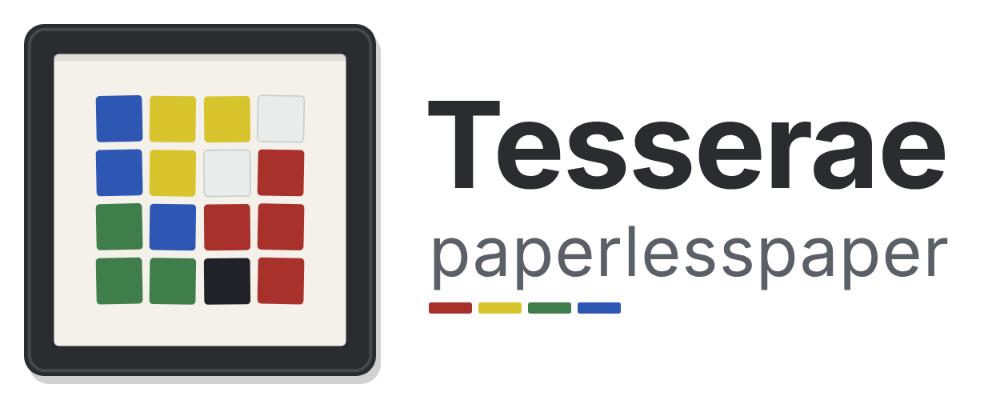

<p align="center">
  
</p>

<h3 align="center">Calm e-ink dashboards, designed in Home Assistant, hung on your wall.</h3>

<p align="center">
  Compose a page in <a href="https://docs.tesserae.ink">Tesserae</a>, and it lands on your
  <a href="https://paperlesspaper.de">paperlesspaper</a> frame: on its own firmware, nothing to flash.
</p>

<p align="center">
  <a href="https://my.home-assistant.io/redirect/supervisor_add_addon_repository/?repository_url=https%3A%2F%2Fgithub.com%2FEmacee%2FTesserae-Paperlesspaper">
    
  </a>
</p>

---

## Why

A paperlesspaper frame is a beautiful, battery-powered Spectra 6 colour
e-paper display. Tesserae is a self-hosted studio for e-ink dashboards, with
widgets for weather, calendars, energy prices, aircraft overhead and more.
This repository puts the two together in **one Home Assistant app**:

- 🖼️ **No flashing.** The frame keeps its stock firmware and its battery life.
  Tesserae renders the page; the frame picks it up at its next wake-up.
- 🔀 **One place to run it all.** Switch a frame between your Tesserae page
  and paperlesspaper's own integrations (XKCD, calendar, photos) from
  Tesserae's sidebar in Home Assistant, and see its battery and last
  wake-up.
- ✈️ **Low flyers over your house.** The bundled Overhead fork paints the
  aircraft near you, now with a height ceiling, so the page shows only the
  helicopters and light aircraft skimming the rooftops.

## How it works

```
Tesserae page ──render──▶ paperlesspaper plugin ──upload──▶ paperlesspaper cloud ──wake-up──▶ your frame
   (in Home Assistant)        (this repo)            (dithers for Spectra 6)       (button or schedule)
```

Each time Tesserae renders a page for a *paperlesspaper* device, the plugin
uploads the image to that frame's paper. The frame shows it at its next
scheduled wake-up, or straight away when you press its button or shake it.
An unchanged page is never uploaded twice.

## Install

1. Click the button above, or in Home Assistant go to **Settings › Apps ›
   App store › ⋮ › Repositories** and add
   `https://github.com/Emacee/Tesserae-Paperlesspaper`.
2. Install **Tesserae + paperlesspaper** and start it.
3. Follow the app's **Documentation** tab
   ([`tesserae_paperless/DOCS.md`](tesserae_paperless/DOCS.md)): add your
   paperlesspaper API key, add a *paperlesspaper* device, link it to a paper,
   and give it a page.

## What's inside

| Part | Folder |
|---|---|
| The Home Assistant app: Tesserae with these widgets and the paperlesspaper bridge | [`tesserae_paperless/`](tesserae_paperless/) |
| **paperlesspaper** (plugin): uploads every render to the frame's paper and manages your frames (which paper is shown, battery, last wake-up) | [`paperlesspaper_core/`](paperlesspaper_core/) |
| Device kind *paperlesspaper frame (stock firmware)*: 1600 × 1200 Spectra 6, push | [`devices/paperlesspaper/`](devices/paperlesspaper/) |
| **Overhead** (fork): aircraft and helicopters above a place, with a radius and a height ceiling, and a map of their tracks | [`overhead_core/`](overhead_core/) + `overhead_cluster/`, `overhead_photo/`, `overhead_plate/`, `overhead_scene/`, `overhead_map/` |
| **Energy, Dynamic Price**: EPEX and Tibber electricity prices for today and tomorrow | [`energy_dynamic_price/`](energy_dynamic_price/) |
| **Travel time**: to work in the morning, home in the afternoon, with the delay against normal, from Waze (or other) sensors in Home Assistant | [`travel_time/`](travel_time/) |
| **Weather, Today**: today's weather as a column, hour by hour, for a narrow portrait cell | [`weather_today/`](weather_today/) |
| **Home batteries**: small rings for the home battery (Deye via Solarman) and the car, with state of charge, target, mode and range | [`home_batteries/`](home_batteries/) |

Each widget folder is a self-contained Tesserae plugin (`plugin.json` +
`server.py`, and `client.js` for widgets).

### How the app is built

Home Assistant builds the image itself from the official
`ghcr.io/dmellok/tesserae` (version in
[`tesserae_paperless/build.yaml`](tesserae_paperless/build.yaml)) and adds the
plugins and the device kind from this repository at the commit in
`WIDGETS_REF`. For a new app version, set the new commit SHA (or a tag) there
and bump `version` in [`tesserae_paperless/config.yaml`](tesserae_paperless/config.yaml).
Every release gets an entry in the
[changelog](tesserae_paperless/CHANGELOG.md), which Home Assistant shows on
the app's Changelog tab.

## Overhead (fork of `dmellok/tesserae-widget-overhead`)

A fork of the official Overhead bundle (v0.11.3, AGPL-3.0-or-later) with:

- **Below** (`max_alt_ft`): a height ceiling, right under **Within** (the
  radius from the **Place**). Only aircraft at or below it (barometric, in
  feet) reach the page; the rest are left out before the count is taken.
  Choices: no ceiling, 500, 1,000, 1,500, 2,000, 3,000, 5,000 or 10,000 ft.
  The page header then reads, for example, *within 10 km, below 1,500 ft*.
- **Overhead: Map**, a fifth widget: the aircraft on an OpenStreetMap map
  of the place, each with its track over the last 10, 30 or 60 minutes,
  coloured by height or by speed (green, ochre, red: the energy chart's
  colours), a numbered badge in its own colour where it is now, and a line
  for each under the map. Up to six; the rest are counted. The tracks come
  from the watch on the place, which now keeps each aircraft's positions
  for two hours. Map tiles are kept on disk for a month.
- **Better helicopter recognition**: about 50 more helicopter types (police
  H135/EC35, air ambulance H145/EC45, coastguard AW189, AS365 Dauphin, NH90,
  Chinook, Apache, Alouette III, Cabri G2, MD 500/600, …), and a type not in
  the table counts as a helicopter when its ADS-B emitter category is A7
  (rotorcraft) or its description says *heli*, *copter*, *rotor* or *gyro*.
  Helicopters work like every other kind: **Helicopters** under *Kinds of
  aircraft*, their own silhouette, and a painting with skids or wheels as the
  type has them.

Only low flyers and helicopters, for example:

| Option | Value |
|---|---|
| Place | your own address |
| Within | 5 or 10 km |
| Below | 1,500 ft (450 m) |
| Kinds of aircraft (More options) | Light aircraft + Helicopters (or just Helicopters) |
| Order (More options) | Lowest first |

**Install**: included in the Home Assistant app above. On its own: copy the
six folders `overhead_core`, `overhead_photo`, `overhead_plate`,
`overhead_cluster`, `overhead_scene` and `overhead_map` together into Tesserae's plugins
folder, in place of the catalog's Overhead bundle (the same widget ids, so
existing cells keep working). The version is `0.11.3+fork.1` (Tesserae only accepts
three numbers with an optional `-`/`+` suffix): a catalog update to 0.11.4 or
later would overwrite the fork.

## Example: a paperlesspaper L page (1200 × 1600, portrait)

Batteries, travel time, the aircraft overhead, electricity prices with the
home battery, and today's weather on one portrait page. Set the device's
panel to portrait (1200 by 1600), then:

| Cell | Widget | Settings |
|---|---|---|
| Left, top (about 440 × 380) | **Home batteries** | The inverter and the car's sensors |
| Left, top right (about 440 × 380) | yours | Free room beside the rings |
| Left, second (about 900 × 230) | **Travel time** | Per person a name and the two sensors; Home from 14:00; At the weekend: Hide |
| Left, third (about 900 × 350) | **Overhead: Map** | Layout: One row; Within 10 km; Below 1,500 ft |
| Left, bottom (about 900 × 550) | **Energy, Dynamic Price** | Home battery: the inverter |
| Right, full height (about 250 × 1570) | **Weather, Today** | Your place; Hours from 07:00 |

Set **Language** to the same on every widget for one language throughout.
Every Home Assistant entity the page reads is picked in the cell's options
and kept as a secret: it never appears in the page's markup or in an
exported template, and none is in this repository.

A cell cannot give its room away, so at the weekend the Travel time cell is
just empty. For a weekend page without it, make a second page and schedule
it for Saturday and Sunday.

## Changelog

See [`tesserae_paperless/CHANGELOG.md`](tesserae_paperless/CHANGELOG.md).

## Development

Offline tests:

```sh
python -m pytest paperlesspaper_core/tests -q
PYTHONPATH=../tesserae python -m pytest overhead_core/tests -q   # needs a Tesserae checkout beside this repo
```

## Licence

The Overhead fork is AGPL-3.0-or-later, as upstream (see
[`overhead_core/LICENSE`](overhead_core/LICENSE) and
[`overhead_core/ATTRIBUTION.md`](overhead_core/ATTRIBUTION.md)). Tesserae is
by [dmellok](https://github.com/dmellok/tesserae); paperlesspaper is by
[paperlesspaper](https://github.com/paperlesspaper). This project is not
affiliated with either.
