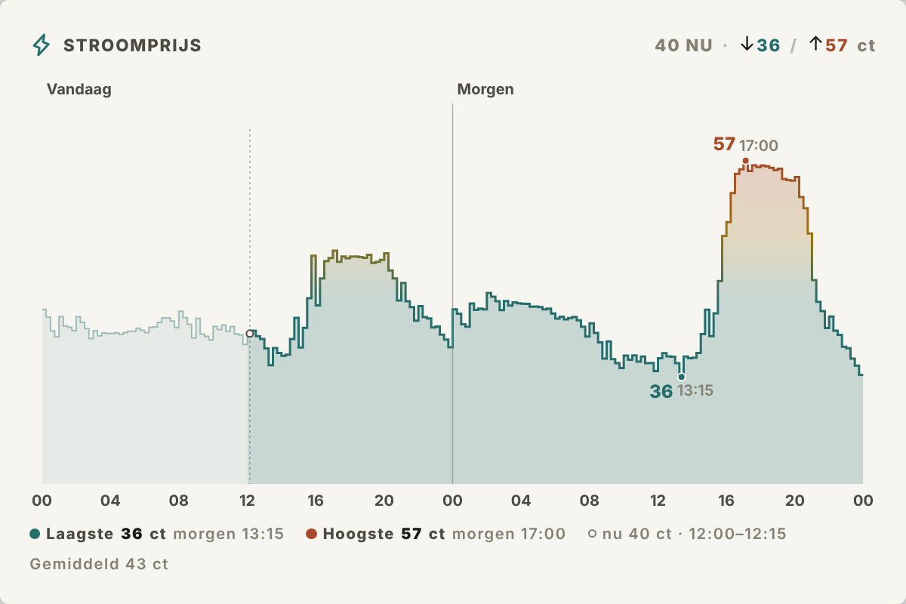
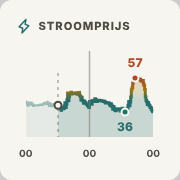
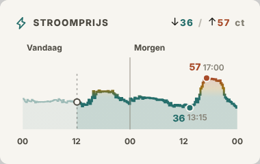
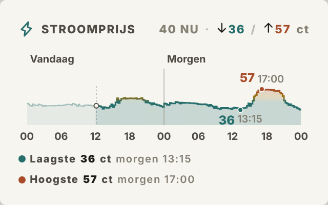
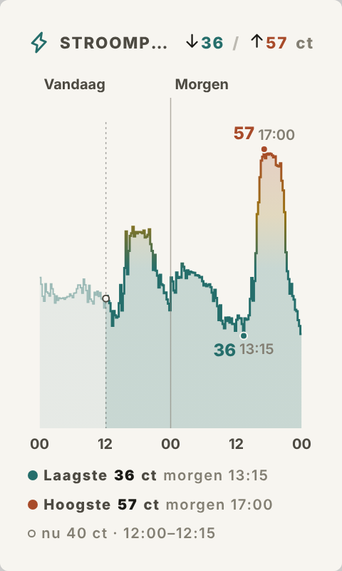
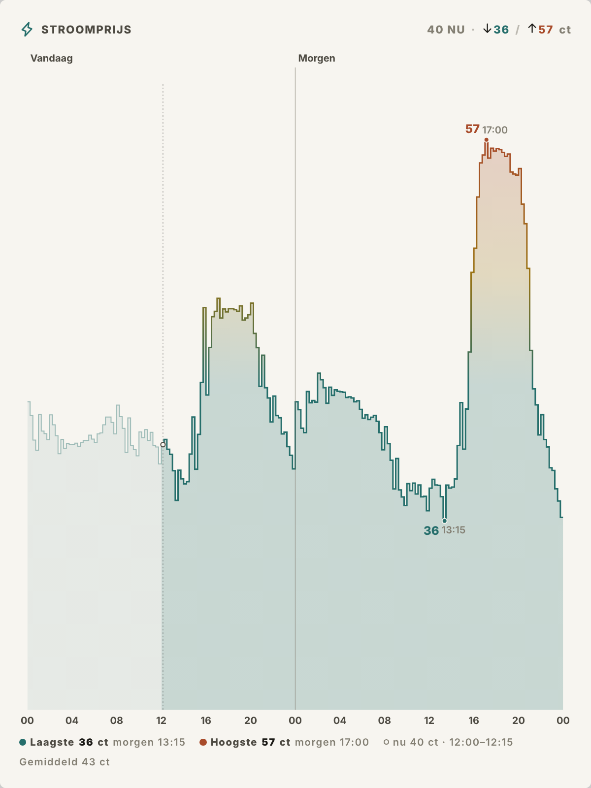

# Energy, Dynamic Price (`energy_dynamic_price`)

Tesserae-widget met de dynamische stroomprijzen (EPEX day-ahead) van vandaag,
en van morgen zodra die bekend zijn (rond 13:00). Opgebouwd in de stijl van
**Weather, Hourly**: een titelbalk met een chip rechtsboven, een grafiek met
een warm-naar-koel verloop, en een legenda eronder.



| xs | sm | md |
|---|---|---|
|  |  |  |

*(De schermafbeeldingen tonen de echte prijzen van vandaag. De prijzen van
morgen zijn verzonnen, want die waren nog niet gepubliceerd.)*

## Wat je ziet

- **Getrapte prijslijn** per kwartier of per uur, zoals in de Tibber-app.
  Onder het gemiddelde kleurt hij `--accent-4` (goedkoop), daarboven loopt
  hij via `--accent-2` naar `--accent-1` (duur). Het verleden is vervaagd.
- **Laagste en hoogste prijs**: een stip op de lijn met de prijs en het
  tijdstip erbij. Ze staan ook in de titelchip (`↓36 / ↑57 ct`) en vanaf md
  in de legenda (met "morgen" als ze op de volgende dag vallen). Standaard
  tellen alleen de komende uren mee, want daar kun je nog op plannen. Onder
  *More options → Lowest / highest over* kun je de hele grafiek kiezen.
- **Huidige prijs, subtiel**: een gestippelde verticale lijn met een open
  ringetje, en een grijze "40 NU" in de chip. Op lg staan in de legenda ook
  het huidige kwartier en het gemiddelde.
- **Vandaag / Morgen**: een scheidingslijn met labels zodra er twee dagen in
  beeld zijn. Zijn de prijzen van morgen er nog niet, dan staat er op lg
  "Prijzen morgen vanaf ~13:00".

## Portrait / paperlesspaper

Getest op portrait-celmaten van de paperlesspaper **OpenPaper 7**
(480×800) en **OpenPaper L** (1200×1600), zowel schermvullend als
half scherm:

| OpenPaper 7, 480×800 | OpenPaper L, 1200×1600 |
|---|---|
|  |  |

- De tekst in de grafiek volgt dezelfde schaal als de rest van de widget
  (`clamp(14px, 7cqmin, 28px)`), dus ook in hoge, smalle cellen blijft hij
  goed leesbaar.
- In smalle cellen (≤ 560 px breed) laat de titelchip "40 NU" weg, zodat de
  titel past. De huidige prijs staat dan in de legenda.
- In smalle én lage cellen (zoals een halve OpenPaper 7, 480×400) toont de
  legenda alleen de huidige prijs. Laagste en hoogste staan al in de chip en
  op de lijn, zo houdt de grafiek zijn hoogte.

## Bronnen

| Bron | Sleutel | Prijs |
|---|---|---|
| **EnergyZero** (standaard) | geen | EPEX NL. Kies uit *all-in incl. btw* (standaard, wat je echt betaalt), all-in excl. btw, kale marktprijs incl. btw, of kale EPEX-prijs. |
| **Tibber** | API-token | De `total`-prijs van je eigen contract, precies wat de Tibber-app toont. |

Voor Tibber maak je een token aan op <https://developer.tibber.com>
(Access token). Plak het daarna in Tesserae onder **Settings → Widgets →
Energy, Dynamic Price → Tibber API token**. Heb je meer dan één huis, vul dan
onder *More options* de `Tibber home ID` in.

## Opties per cel

| Optie | Waarden |
|---|---|
| Price source | `energyzero` · `tibber` |
| Price (alleen EnergyZero) | `all_in_with_vat` · `all_in` · `base_with_vat` · `base` |
| Show | `auto` (vandaag + morgen als die bekend is) · `ahead` (vanaf nu) · `today` |
| Interval | `15` · `60` minuten |
| Title | leeg = "Stroomprijs" / "Electricity price" (volgt de taal) |
| Lowest / highest over *(advanced)* | `upcoming` · `window` |
| Decimals *(advanced)* | `0` · `1` |

Fragments voor het vrije canvas: `full`, `summary` (nu · laag / hoog) en
`chart`. Vertalingen: en, nl, de.

## Installeren

Zip de map `energy_dynamic_price/` en upload hem in Tesserae via
**Settings → Widgets → Upload widget**. Of zet de map in `plugins/` van een
Tesserae-checkout.

## Testen

```sh
# serverlogica (netwerk gemockt), zonder Tesserae-checkout:
python3 -m unittest discover -s energy_dynamic_price/tests -p "test_server.py"

# render-smoketest, binnen een Tesserae-checkout (plugins/energy_dynamic_price):
.venv/bin/python -m pytest plugins/energy_dynamic_price/ -q
```

Ruwe prijzen worden 15 minuten gecachet in `data_dir`. "Nu", het venster en
de laagste en hoogste prijs worden bij elke render opnieuw berekend.
