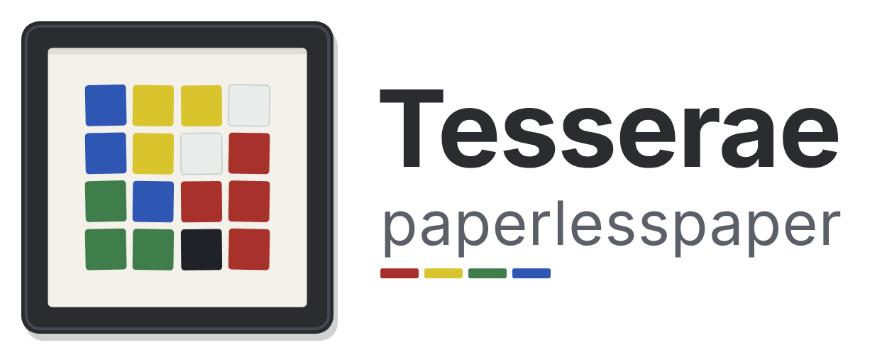

# Tesserae + paperlesspaper

**Calm e-ink dashboards, designed in Home Assistant, hung on your wall.**

Compose pages in Tesserae, right here in Home Assistant's sidebar, and send
them to your paperlesspaper frame on its own firmware. Nothing to flash.

- 🖼️ **No flashing.** The frame keeps its firmware and its battery life; it
  picks up the new page at its next wake-up.
- 🔀 **Everything in one place.** Switch a frame between your Tesserae page
  and paperlesspaper's own integrations, and see its battery and last wake-up.
- ✈️ **Overhead, low and slow.** Paintings of the aircraft above your house,
  with a height ceiling for just the helicopters and light aircraft.

Open the **Documentation** tab to set it up in five minutes.
